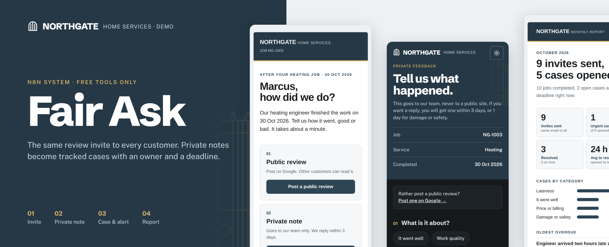
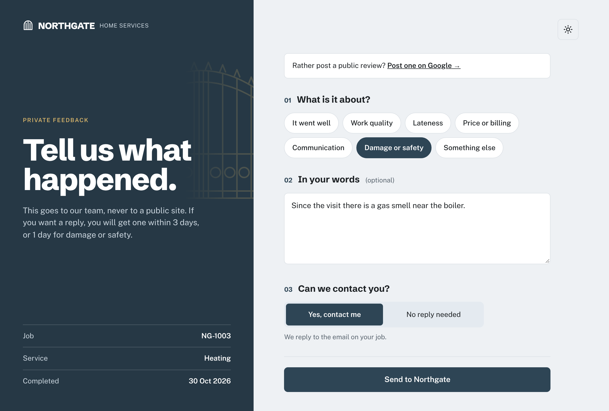
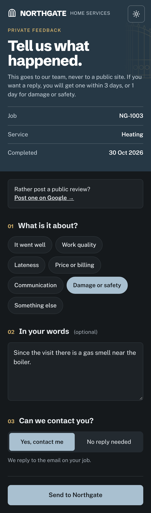
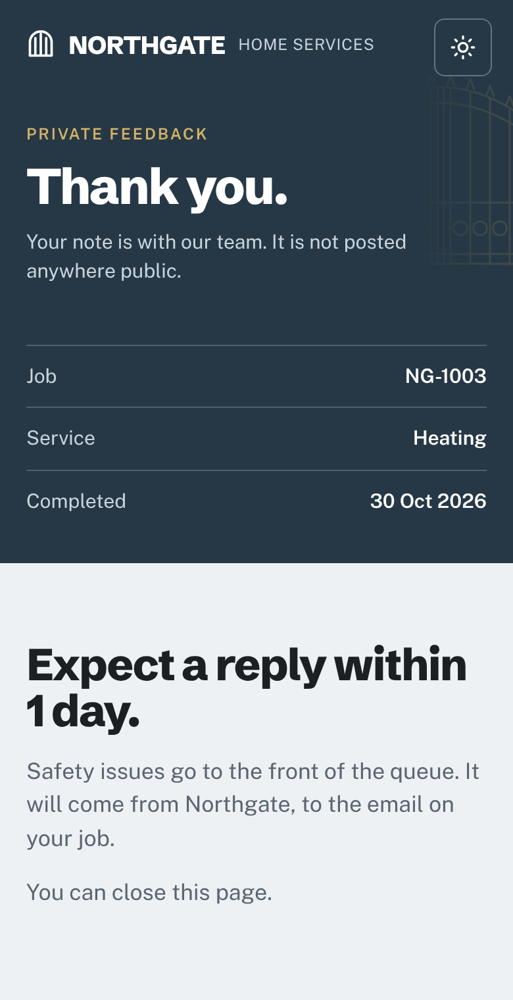
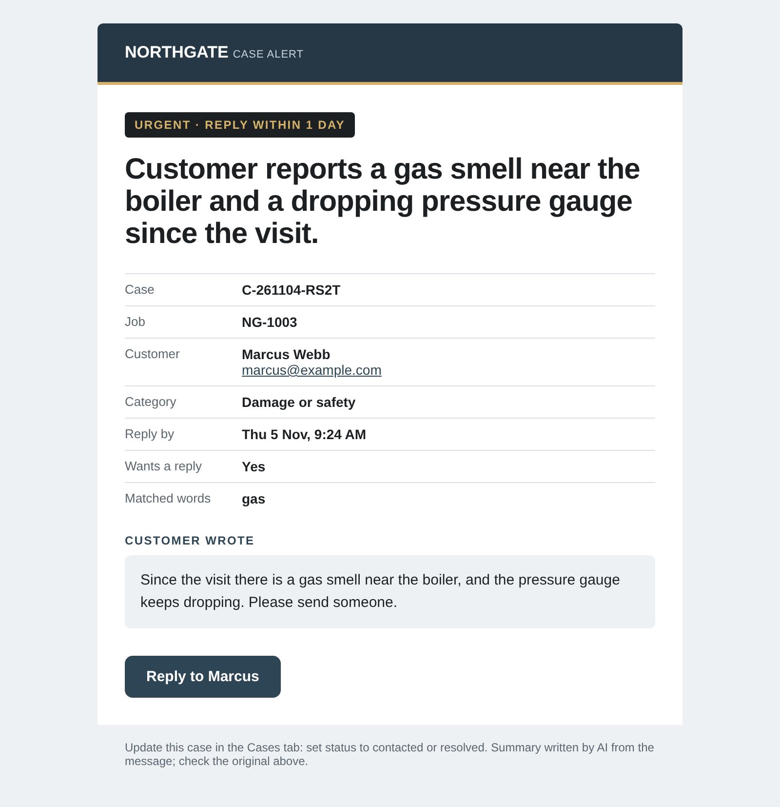
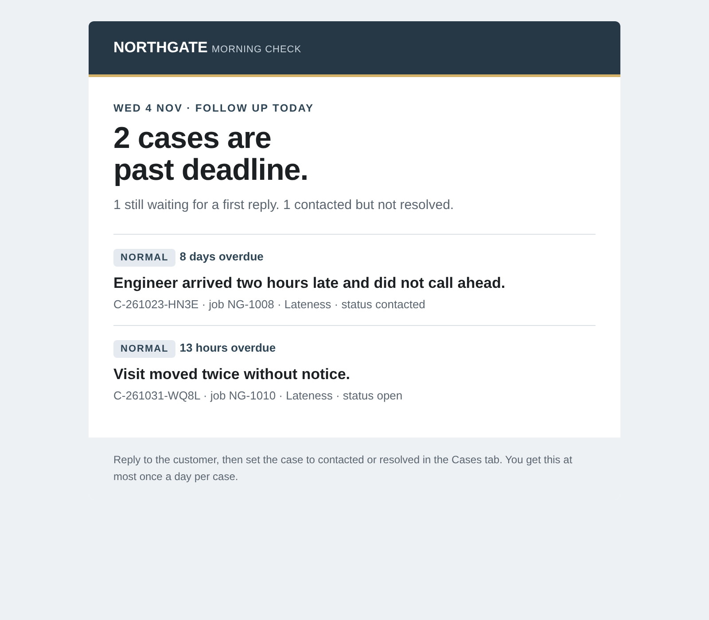
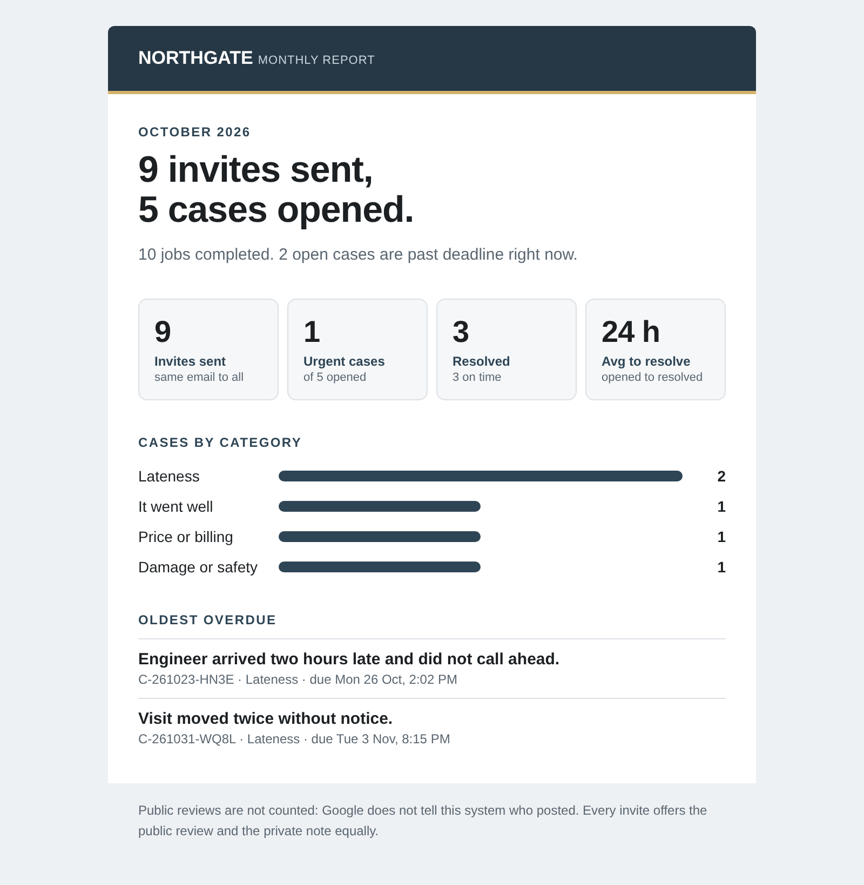
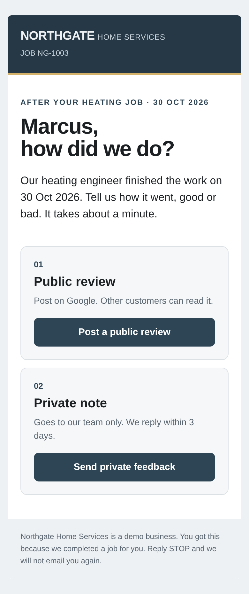

# Fair Ask — review requests that don't cheat

A small n8n system for a home-services business (demo: **Northgate Home Services**, plumbing, electrical and heating).
After a job is finished, every eligible customer gets the **same** neutral email: leave a public review, or send a private note. Private notes become tracked cases with an owner and a deadline, nobody is left waiting without a reminder, and the owner gets a one-screen report every month.



## What it does

| Workflow | When | Job |
|---|---|---|
| **FA2 · Invite engine** | daily 10:00 | Finds jobs completed 2–14 days ago and sends one invite per customer. Everything else is skipped with a written reason. |
| **FA3 · Feedback triage** | when the private page is opened or sent | Serves the private feedback page itself, then turns every message into a case: category, severity, owner, deadline. Urgent cases email the owner straight away. |
| **FA4 · Recovery tracker** | daily 09:00 | One "morning check" email per owner listing their overdue cases. A case is chased at most once a day. |
| **FA5 · Monthly report** | 1st of the month, 08:00 | Invites sent, private notes, cases by category, time to resolve, oldest overdue. |
| **FA0 · Reset demo** | manual | Puts the demo Sheet back to its starting state. |
| **e0 · Error alerts** | any failed production run | Emails the workflow, the failed node, the error and a link to the run. Shared with my other n8n projects. |

Everything runs on free tools: n8n Community Edition, one Google Sheet, Gmail SMTP with an app password, and (optionally) Groq for one-line summaries.

## What it replaces

Many review tools quietly send only happy customers to Google and route unhappy ones somewhere private. That is called *review gating*, and Google's review policy does not allow it. Fair Ask does the opposite on purpose:

- **R1** every eligible customer gets the same email. No sentiment check decides who sees the public link.
- **R2** the public and private options are the same size, same colour, same button.
- **R3** no incentives, no quotas, no asking for specific words or staff names.
- **R4** the public review link is in 100% of invites. The workflow refuses to send if the link is missing.

It also replaces the shared inbox where complaints get read once and forgotten.

## How it works

```
Jobs tab ──► FA2 decide ──► send invite ──► Jobs: sent / skipped(reason) / failed
                                 │
                 customer clicks "Send private feedback"
                                 ▼
          FA3 page ──► triage rules ──► (Groq one-line summary, optional)
                         │                         │
                    Feedback tab               Cases tab ──► urgent? email owner
                                                  │
          FA4 every morning: overdue cases ──► one email per owner ──► Log tab
          FA5 every month: Jobs + Cases + Feedback ──► report email
```

- **Rules first, AI second.** Category and severity come from the customer's choice and a keyword list in Config (gas, leak, fire, smoke…). Groq only writes a one-line summary, and if Groq is down, slow, or returns anything with links or markup, the first words of the message are used instead.
- **Config tab drives everything:** wait days, window, dedupe days, deadlines, owners per category, urgent keywords, send caps, `dry_run`.
- **Everything is logged** in the Log tab, so a run can be checked without opening n8n.

## What it handles

| Situation | Behaviour |
|---|---|
| Completed yesterday / today | skipped `too_soon` (retried later) |
| Older than 14 days | skipped `too_old` |
| Cancelled or still in progress | skipped `not_completed` |
| Missing or broken email | skipped `missing_email` / `invalid_email` |
| Customer opted out | skipped `opted_out` |
| Same customer, two jobs | older job invited, the other skipped `duplicate_email` (case and spaces ignored) |
| Customer invited in the last 30 days | skipped `recent_invite` |
| Workflow run twice | no second invite |
| Gmail refuses a send | job marked `failed`, retried next run, never duplicated |
| More than 40 eligible jobs | 40 sent, the rest wait for the next run |
| Blank, missing-job or tampered form | case still created and flagged `[Check by hand: …]` |
| Bot fills the hidden trap field | thank-you page shown, nothing saved, nobody alerted |
| Hostile text (`<script>`, `=HYPERLINK(…)`, "ignore previous instructions") | escaped in every email, stored as plain text, AI summary skipped |
| Someone floods the form | after 5 urgent cases an hour, or 3 per job per day, cases are still saved but alert emails stop |
| Owner cell changed to an outside address | morning check goes only to owners listed in Config |
| 500 overdue cases | one email, first 25 listed, "and N more" |
| Empty month | report says "A quiet month." |

## How it was tested

**1. The 18-test matrix, run live on n8n (3–4 Nov 2026).** Full results with times: [docs/test-results.md](docs/test-results.md).

| | Test | Result |
|---|---|---|
| T1 | Normal eligible job gets exactly one invite | ✅ 19 sent in 87 s, the 20th hit Gmail's daily cap (see T10) |
| T2–T7 | Too soon, too old, cancelled, missing email, broken email, opted out | ✅ all skipped with the right reason |
| T8 | Run twice | ✅ second run: 0 sends |
| T9 | Same customer twice in 30 days | ✅ one invite |
| T10 | SMTP failure | ✅ happened for real (Gmail daily cap): marked `failed`, retried, no duplicate |
| T11 | Urgent keyword | ✅ urgent case, owner alerted |
| T12 | Blank message | ✅ case created and flagged |
| T13 | Groq down | ✅ unreachable host: rules summary used, case created |
| T14 | Overdue case | ✅ one reminder; second run same day sent 0 |
| T15 | Report with no data | ✅ "A quiet month.", no errors |
| T16 | Public link in every invite | ✅ 39 of 39 live invites, 5,000 of 5,000 fuzz runs |
| T17 | Hostile text | ✅ escaped everywhere, formula stored as text |
| T18 | Missing / edited / unknown job id | ✅ case created, flagged, no crash |

**2. Break-test, round 1: 21 targeted attacks.** 7 broke the first version (built-in names like `constructor` leaking code into emails, a line break reaching the subject line, 5,000-email runs, alert mail-bombing through the form, case details sent to an address typed into the Sheet, a 261 KB digest Gmail would clip, an invalid month in the report). All 7 fixed and re-tested. Log: [docs/break-test-log.md](docs/break-test-log.md).

**3. Break-test, round 2: invariant fuzzing.** 5,000 random runs of hostile values (objects posing as text, `__proto__`, `NaN`, 5,000-character strings, emoji, CRLF, formulas) through the five main code nodes (invite decisions, triage, case finalizing, overdue check, report). One more crash found and fixed: a date cell holding `NaN` or `Infinity` broke the invite engine and the report. Final run **5,000 / 0 failures**.

Run the tests yourself:

```bash
npm install
npm test        # TestKey (40 jobs) + 21 attacks + 5,000 fuzz runs + 23 page checks
```

## The private feedback page

The customer lands on a page that FA3 builds itself (a Webhook node that answers with its own HTML), not n8n's stock form. That is what allows the split layout, the job facts read from the Sheet, the light/dark switch, and a styled thank-you page. Under 860px wide it stacks into one column.

| Desktop | Phone, dark | After sending |
|---|---|---|
|  |  |  |

The page answers before the case is filed, so the customer never waits on Sheets, Groq or email. The public review link sits at the top of the form, before question 01, so the private route never hides it. The first category is "It went well": the private route is for any feedback, not only complaints. The thank-you page promises 1 day when Triage will treat the note as urgent, 3 days otherwise, and nothing when the customer asked for no reply.

## Sample output

| Case alert | Morning check |
|---|---|
|  |  |

| Monthly report | Phone |
|---|---|
|  |  |

## Setup

1. **Sheet.** Upload `data/fair-ask-sheet.xlsx` to Google Drive → *Open with → Google Sheets* → *File → Save as Google Sheets*. Replace `you+…@example.com` with real test inboxes (Gmail `+` addressing works).
   *Optional look:* in that Sheet, **Extensions → Apps Script**, paste [`data/fair-ask-sheet-format.gs`](data/fair-ask-sheet-format.gs), save, and run `formatFairAsk`. It adds the header colours, banded rows, status colours and dropdowns, and never touches data. Create the script from inside the Sheet: a standalone script can't find the spreadsheet.
2. **Config tab.** Set `from_email` (must be the Gmail account that sends), `alert_email`, owner emails, and keep `dry_run = yes` for the first run.
3. **Credentials in n8n.** Google Sheets (OAuth2), SMTP (`smtp.gmail.com`, port 465, SSL, Gmail app password), Groq (optional).
4. **Import** the six files in `workflows/` (*Overview → Create → Import from file*), **e0 first**. In every Google Sheets node pick your Sheet; in every email node pick your SMTP credential, and set e0's from/to address.
5. **Error alerts.** In FA2, FA3, FA4 and FA5: **⋯ → Settings → Error Workflow → e0 · error-alerts**. Exports don't carry this setting, so it has to be set by hand. Without it a crashed run (Google access expired, Sheets down) fails silently.
6. **Dry run.** Run FA2 manually. With `dry_run = yes` it decides but sends and writes nothing. Compare with the TestKey tab.
7. **Go live.** Set `dry_run = no`, run FA2, then publish FA2, FA3, FA4 and FA5. The private-feedback link only works on the **production** URL (`…/webhook/northgate-feedback`), so FA3 must be published. If n8n sits behind a domain or tunnel, set `feedback_form_url` in Config to that public address.

## Known limitations

- **Public reviews can't be counted.** Google doesn't tell n8n who posted, so the report counts invites and private notes only.
- **Gmail's real sending cap is much lower than the "500 a day" usually quoted.** In testing, fresh accounts were blocked after roughly 25–40 automated emails in 24 hours. A real business should send from its own domain through a proper email service.
- **When Gmail itself is down, the failure alert can't arrive either.** The failure is still recorded in the Jobs and Log tabs.
- **Anyone with the form link can claim a job number.** The link isn't signed, so a case could be filed against someone else's job. Unknown job numbers are flagged; spoofed real ones are not.
- **Keyword rules miss tricks** like "g a s" and mixed-language messages; those stay `normal` unless the customer picks *Damage or safety*.
- **The AI summary can add small details** that weren't in the message ("charged twice" → "charged twice for the same transaction"). The alert always shows the original message under it.
- Calendar-day deadlines, English only, one timezone (Asia/Karachi), demo data only. Google OAuth for Sheets may need reconnecting if the Google app is in testing mode.
- "Reply STOP" opt-outs are handled by hand: the owner sets `opted_out = Y`.
- n8n serves webhook pages in a browser sandbox, so the light/dark choice is not remembered between visits; the page follows the device setting by default.

## Files

```
workflows/   n8n exports (IDs, emails and Sheet ID removed)
src/         the JavaScript inside each Code node, including the feedback page
tests/       TestKey check, attack suite, fuzzer, feedback-page checks
data/        demo Sheet with 40 fake jobs and the expected result for each, plus the Sheet formatting script
docs/        design spec, test results with times, break-test log
assets/      screenshots
```

All people, emails and jobs in this repo are fictional. Northgate Home Services is not a real company.

MIT License.
